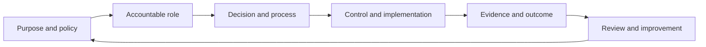
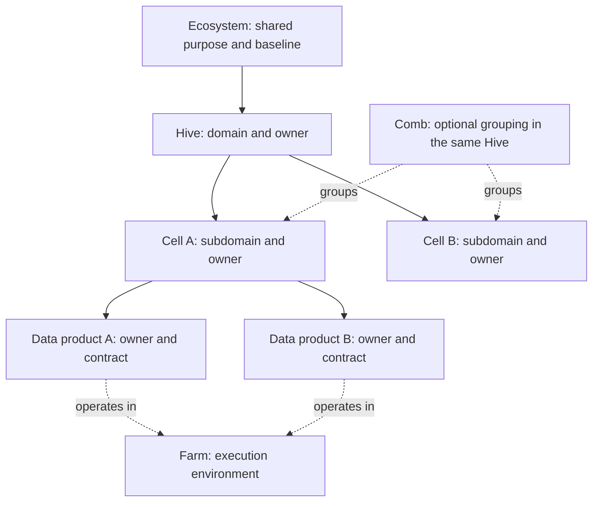

# From reference implementation to operating model

This is an original conceptual abstraction, edition 0.1. KDV's project/process/product documentation supplies practical examples of responsibilities and evidence. It is not copied as a software specification or represented as a claim that every proposed product capability is deployed.

## The chain of responsibility

For example, a policy permitting a particular use of a classified product has a scoped owner, an approval path, a technical enforcement action, an implementation check and a review/expiry decision. A catalogue entry by itself does not prove authorised access or fitness for purpose.

## Business organisation and execution

A Cell can participate in more than one Comb. A Comb does not create a new infrastructure level or an additional role. Execution environment and business accountability must not be collapsed into a single hierarchy. A product owner is distinct from domain/subdomain ownership, even if held by the same person.

## Operational roles and interaction perspectives

The website role register identifies the governance forum, ecosystem manager, domain owner, subdomain owner, product owner, operational steward, coordinating steward, engineering, technical custodian and consumer. Assign responsibilities explicitly and record the acting role in each decision.

Consumer, Producer, EcOps and PlatOps are ways to interact with a reference implementation. A screen name does not replace an approval authority, segregation of duties or an accountable business role. Other tools may support the same work.

## A minimal baseline with local flexibility

Named ownership, a versioned contract, classification, policy-based access and an audit trail are the shared minimum. An ecosystem may adapt terminology, combine roles, set thresholds, choose approval routes and define review cadences. Local freedom requires visible responsibility, not silent exceptions.

## Evidence through the lifecycle

| Stage | Operating intent | Example evidence |
| --- | --- | --- |
| Cultivate | Prepare an authorised source for an intended purpose | Inventory, provenance, reproducible transforms, initial tests |
| Govern | Agree meaning, ownership, quality and conditions | Glossary, classification, contract, approvals |
| Share | Make a product discoverable and accessible under agreed rules | Publication, access decision, applied policy, version record |
| Activate | Use data and learn from outcomes | Usage, outcome measure, incidents, feedback and review |

An exception needs an owner, a reason, a risk decision and a review/expiry point. Weekly or monthly review frequencies on the website are suggestions for a first operating rhythm, not universal mandates.

## Relation to good practices

- DAMA-DMBOK 2 informs vocabulary across governance, metadata, quality, security and operations.
- DCAM informs the attention to capabilities and observable evidence of improvement. KDV does not publish a DCAM assessment, score or equivalence scale.
- Data Mesh informs domain ownership, data products, self-service and federated computational governance.

These connections are original and illustrative. They do not replace the source publications or constitute an official crosswalk. Source material is not reproduced. The framework can support privacy practices, analytics and AI preparation, but does not guarantee legal compliance, data quality or an AI system's fitness.
