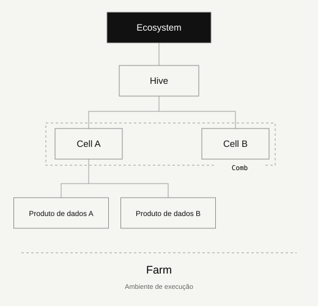

# Anatomia do ecossistema

Distinga domínios, agrupamentos, produtos e execução.

## Propósito

As colmeias e a apicultura oferecem uma linguagem para cooperação, responsabilidade local e cuidado com o todo. É uma metáfora organizacional: pessoas, direitos de decisão e produtos de dados permanecem explícitos.

## Ecosystem / Propósito comum

O limite da colaboração: objetivos, domínios participantes, políticas comuns e governança responsável. Comece por um caso de uso e um patrocinador identificado.

**Evidências típicas:** Política, registro de decisões, indicador de valor.

## Hive / Domínio de negócio

Um domínio com dono responsável, significado e prioridades próprios. Coordena suas Cells e respeita as regras mínimas do ecossistema.

**Evidências típicas:** Carta do domínio, dono, glossário.

## Cell / Subdomínio de negócio

Um subdomínio dentro de uma Hive. Stewardship e engenharia trabalham perto dos dados. Uma Cell pode ter vários produtos; a Cell não é o produto.

**Evidências típicas:** Steward, regras de qualidade, inventário de produtos.

## Comb / Agrupamento de negócio

Agrupamento opcional de Cells da mesma Hive. Uma Cell pode pertencer a vários Combs. É um agrupamento de negócio e permissões, não outra camada de infraestrutura.

**Evidências típicas:** Critérios de agrupamento, responsabilidades por escopo.

## Produto de dados / Uma oferta com responsável

Uma oferta com propósito, dono identificado, contrato versionado, consumidores conhecidos, expectativas de qualidade e ciclo de vida. Tabelas, APIs e dashboards podem ser interfaces de entrega.

**Evidências típicas:** Contrato, testes, registro de acesso, utilização.

## Farm / Ambiente de execução

Onde os produtos são cultivados e operados: produção, teste ou desenvolvimento. A Farm delimita a execução e é distinta da responsabilidade de negócio.

**Evidências típicas:** Inventário, controles de acesso, evidência de recuperação.

## Escopo e limites

A metáfora ajuda a explicar o modelo. Não substitui os termos da organização nem atribui papéis humanos com base na biologia das abelhas.

## Limites de negócio antes do organograma

Um domínio de negócio é uma área coerente de significado e responsabilidade de decisão; não precisa de coincidir com um departamento. Várias unidades podem contribuir com acordos explícitos. O ambiente de execução não é a hierarquia de negócio.

## Continuar a leitura

- [Exemplo completo em dois contextos de interesse público](worked-example.md)
- [Aplicar o modelo](implementation.md)

---

Conhecimento original KDV. Edição comunitária 1.2.0. CC BY 4.0. Direitos de terceiros reservados.

[GitHub](https://github.com/kolmeia-dataecosystems/kdv-framework) · [CC BY 4.0](https://creativecommons.org/licenses/by/4.0/)
