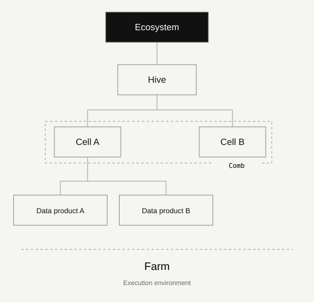

# Ecosystem anatomy

Distinguish business domains, groupings, products and execution.

## Purpose

Hives and beekeeping give us a language for cooperation, local responsibility and care for the whole. It is an organisational metaphor: people, decision rights and data products remain explicit.

## Ecosystem / Shared purpose

The boundary of collaboration: objectives, participating domains, common policies and accountable governance. Start with a use case and a named sponsor.

**Typical evidence:** Policy, decision log, value indicator.

## Hive / Business domain

A domain with an accountable owner, its own meaning and priorities. It coordinates its Cells while respecting the ecosystem’s minimum rules.

**Typical evidence:** Domain charter, owner, glossary.

## Cell / Business subdomain

A focused subdomain inside a Hive. Stewardship and engineering work close to the data. A Cell can own several data products; the Cell is not itself a product.

**Typical evidence:** Steward, quality rules, product inventory.

## Comb / Business grouping

An optional grouping of Cells within the same Hive. A Cell may belong to several Combs. This is a business and permission grouping, not an extra infrastructure layer.

**Typical evidence:** Grouping criteria, scoped responsibilities.

## Data product / An accountable offering

A purposeful offering with a named owner, versioned contract, known consumers, quality expectations and a lifecycle. Tables, APIs and dashboards can be delivery interfaces.

**Typical evidence:** Contract, tests, access record, usage.

## Farm / Execution environment

Where products are cultivated and operated: production, test or development environments. The Farm is an execution boundary, distinct from business ownership.

**Typical evidence:** Inventory, access controls, recovery evidence.

## Scope and limitations

The metaphor helps explain the model. It does not replace an organisation’s terminology or assign human roles based on bee biology.

## Business boundaries before an organisation chart

A business domain is a coherent area of meaning and decision responsibility; it need not coincide with a department. Multiple organisational units can contribute under explicit agreements. An execution environment is not the business hierarchy.

## Continue reading

- [Worked example across two public-interest contexts](worked-example.md)
- [Applying the model](implementation.md)

---

Original KDV knowledge. Proposed community edition 1.1 for review; not an accepted release. CC BY 4.0. Third-party rights remain reserved.

[GitHub](https://github.com/kolmeia-dataecosystems/kdv-framework) · [CC BY 4.0](https://creativecommons.org/licenses/by/4.0/)
