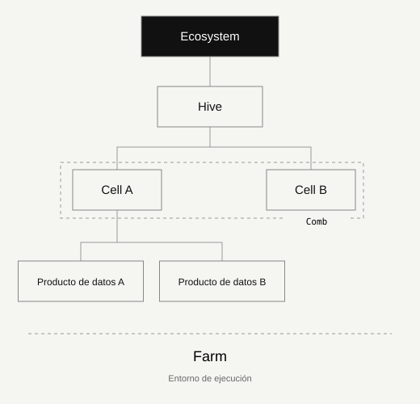

# Anatomía del ecosistema

Distinga dominios, agrupaciones, productos y ejecución.

## Propósito

Las colmenas y la apicultura ofrecen un lenguaje para la cooperación, la responsabilidad local y el cuidado del conjunto. Es una metáfora organizativa: personas, derechos de decisión y productos de datos permanecen explícitos.

## Ecosystem / Propósito compartido

El límite de la colaboración: objetivos, dominios, políticas comunes y gobernanza responsable. Empiece con un caso de uso y un patrocinador identificado.

**Evidencias habituales:** Política, registro de decisiones, indicador de valor.

## Hive / Dominio de negocio

Un dominio con responsable, significado y prioridades propios. Coordina sus Cells y respeta las reglas mínimas del ecosistema.

**Evidencias habituales:** Carta del dominio, responsable, glosario.

## Cell / Subdominio de negocio

Un subdominio dentro de una Hive. Stewardship e ingeniería trabajan cerca de los datos. Una Cell puede tener varios productos; la Cell no es el producto.

**Evidencias habituales:** Steward, reglas de calidad, inventario de productos.

## Comb / Agrupación de negocio

Agrupación opcional de Cells de la misma Hive. Una Cell puede pertenecer a varios Combs. Agrupa negocio y permisos; no añade una capa de infraestructura.

**Evidencias habituales:** Criterios de agrupación, responsabilidades por ámbito.

## Producto de datos / Una oferta con responsable

Una oferta con propósito, responsable, contrato versionado, consumidores conocidos, expectativas de calidad y ciclo de vida. Tablas, APIs y dashboards pueden ser interfaces de entrega.

**Evidencias habituales:** Contrato, pruebas, registro de acceso, uso.

## Farm / Entorno de ejecución

Donde se cultivan y operan los productos: producción, pruebas o desarrollo. La Farm delimita la ejecución, separada de la responsabilidad de negocio.

**Evidencias habituales:** Inventario, controles de acceso, evidencia de recuperación.

## Alcance y límites

La metáfora explica el modelo. No sustituye los términos de la organización ni asigna roles humanos a partir de la biología de las abejas.

## Límites de negocio antes que el organigrama

Un dominio es un área coherente de significado y responsabilidad de decisión; no tiene que coincidir con un departamento. Varias unidades pueden contribuir con acuerdos explícitos. El entorno de ejecución no es la jerarquía de negocio.

## Continuar leyendo

- [Ejemplo completo en dos contextos de interés público](worked-example.md)
- [Aplicar el modelo](implementation.md)

---

Conocimiento original KDV. Propuesta de edición comunitaria 1.1 para revisión; no es una release aceptada. CC BY 4.0. Derechos de terceros reservados.

[GitHub](https://github.com/kolmeia-dataecosystems/kdv-framework) · [CC BY 4.0](https://creativecommons.org/licenses/by/4.0/)
